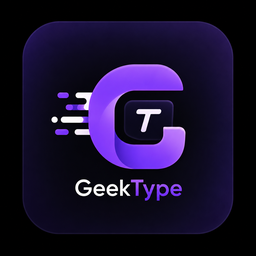

<p align="center">
  
</p>

# GeekType

> در حال تایپی، ولی لایوت کیبورد اشتباهه؟ یه کلید بزن، درستش کن.
> Typing with the wrong keyboard layout active? One key fixes it.

یه ابزار سبک و سراسری (system-wide) برای لینوکس، الهام‌گرفته از LangOver، که متن اشتباه‌تایپ‌شده (فارسی/انگلیسی) رو با یه کلید به لایوت درست تبدیل می‌کنه — تو هر برنامه‌ای، نه فقط مرورگر.

A lightweight, system-wide layout-fixer for Linux, inspired by LangOver. Select text typed in the wrong keyboard layout (Persian/English), hit one key, and it's fixed — in any app, not just the browser.

---

## فارسی

### چطور کار می‌کنه؟
هر کلید فیزیکی روی کیبورد، بسته به لایوت فعال، یه کاراکتر متفاوت تولید می‌کنه. وقتی با لایوت اشتباه تایپ می‌کنی (مثلاً می‌خواستی فارسی بنویسی ولی لایوت انگلیسی فعال بوده)، همون کلیدهای فیزیکی درست زده شدن، فقط خروجی از لایوت غلط اومده. GeekType متن رو کاراکتر به کاراکتر می‌گیره، موقعیت فیزیکی کلید رو پیدا می‌کنه، و کاراکتر معادلش تو لایوت دیگه رو جایگزین می‌کنه.

### امکانات
- کار می‌کنه تو **هر برنامه‌ای** (ادیتور متن، مرورگر، تلگرام دسکتاپ، هر جا)
- یه کلید (**F9**) برای تبدیل متن انتخاب‌شده
- نوتیفیکیشن کوچیک بعد از هر تبدیل
- نصب خودکار با یه اسکریپت

### نصب (اوبونتو / GNOME / Wayland)

**روش ۱ — دانلود AppImage (ساده‌ترین راه):**
از صفحه‌ی [Releases](../../releases) آخرین نسخه‌ی `GeekType-x86_64.AppImage` رو دانلود کن، بعد:
```bash
chmod +x GeekType-x86_64.AppImage
./GeekType-x86_64.AppImage --install
```
این دستور خودش پیش‌نیازها رو نصب می‌کنه، سرویس پس‌زمینه رو راه می‌ندازه، و شورتکات **F9** رو تو GNOME ثبت می‌کنه.

**روش ۲ — از سورس:**
```bash
git clone https://github.com/mani-imani/GeekType.git
cd GeekType
chmod +x setup.sh
./setup.sh
```

بعد از هر دو روش، هر جا متن اشتباه‌تایپ‌شده‌ای رو سلکت کن و **F9** بزن.

### ساخت AppImage از سورس
```bash
chmod +x build-appimage.sh
./build-appimage.sh
```
فایل نهایی توی `appimage/GeekType-x86_64.AppImage` ساخته می‌شه.

### پیش‌نیازها
اسکریپت `setup.sh` این‌ها رو خودکار نصب می‌کنه:
- `wl-clipboard`
- `ydotool` / `ydotoold`
- `libnotify-bin`

### وضعیت فعلی
فعلاً فقط لینوکس (GNOME/Wayland) پشتیبانی می‌شه. نسخه‌ی ویندوز فعلاً در برنامه نیست.

---

## English

### How it works
Every physical key produces a different character depending on the active layout. When text is typed in the wrong layout, the correct physical keys were pressed — just under the wrong layout. GeekType maps each character back to its physical key position and substitutes the equivalent character from the other layout.

### Features
- Works **system-wide**, in any application (text editors, browsers, desktop Telegram, anywhere)
- One hotkey (**F9**) fixes the selected text
- Small desktop notification confirms the fix
- One-command automated setup

### Install (Ubuntu / GNOME / Wayland)

**Option 1 — Download the AppImage (simplest):**
Grab the latest `GeekType-x86_64.AppImage` from [Releases](../../releases), then:
```bash
chmod +x GeekType-x86_64.AppImage
./GeekType-x86_64.AppImage --install
```
This installs dependencies, starts the background service, and registers the **F9** shortcut in GNOME.

**Option 2 — From source:**
```bash
git clone https://github.com/mani-imani/GeekType.git
cd GeekType
chmod +x setup.sh
./setup.sh
```

Either way, select any wrongly-typed text anywhere and press **F9**.

### Building the AppImage from source
```bash
chmod +x build-appimage.sh
./build-appimage.sh
```
Produces `appimage/GeekType-x86_64.AppImage`.

### Requirements
`setup.sh` installs these automatically:
- `wl-clipboard`
- `ydotool` / `ydotoold`
- `libnotify-bin`

### Current status
Linux (GNOME/Wayland) only for now. A Windows version is not currently planned.

---

## License
MIT
